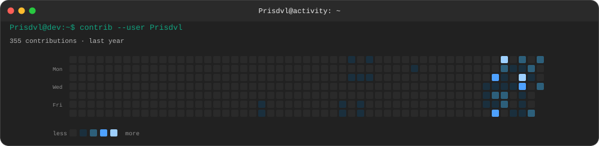

# Prisdvl

[Prisdvl](https://github.com/Prisdvl)

Java backend dev building agent & RAG platforms · Nanchang University

**Java Backend Engineer · Spring AI agents · RAG · distributed systems**

> online · open to 2027 summer internship \(backend / AI infra\)

  <picture>
    <source media="(prefers-reduced-motion: reduce)" srcset="assets/terminal-static-enhanced.svg">
    
  </picture>

## Skills

- **Java** - 85%
- **Spring Boot** - 85%
- **MySQL** - 75%
- **Redis** - 70%
- **Spring Cloud** - 65%
- **Spring AI** - 65%
- **RAG / Agent** - 65%
- **RabbitMQ** - 60%
- **Docker** - 60%
- **TypeScript** - 55%
- **React** - 55%
- **Rust / Tauri** - 40%

## Selected Projects

- **[prisdvl-nexus](https://github.com/Prisdvl/prisdvl-nexus)** - `Spring AI` · personal KB · hybrid RAG · tool-calling agent · MCP
- **[Prisdoc](https://github.com/Prisdvl/Prisdoc)** - `Spring Cloud` · doc workspace · Nacos gateway · RAG Q&A · agent approval
- **[PrisEcho](https://github.com/Prisdvl/PrisEcho)** - `Java/Redis` · social feed · heat-rank sharding · atomic stock · reliable MQ
- **[prisdvl-order](https://github.com/Prisdvl/prisdvl-order)** - `Spring Boot` · takeaway orders · N\+1 fixed · JWT/RBAC · idempotent pay
- **[PrisTimer](https://github.com/Prisdvl/PrisTimer)** - `Rust/Tauri` · liquid-glass focus timer · anchor time engine
- **[Kakuki](https://github.com/Prisdvl/Kakuki)** - `TS/React` · blog & portfolio · Hono on Workers · D1

  

---

Generated from `profile.config.json` with the CRT GitHub Profile template. Run `npm run generate` after changing the configuration.
